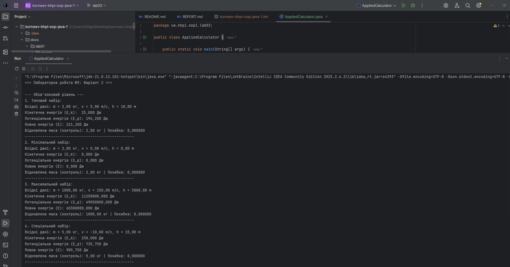
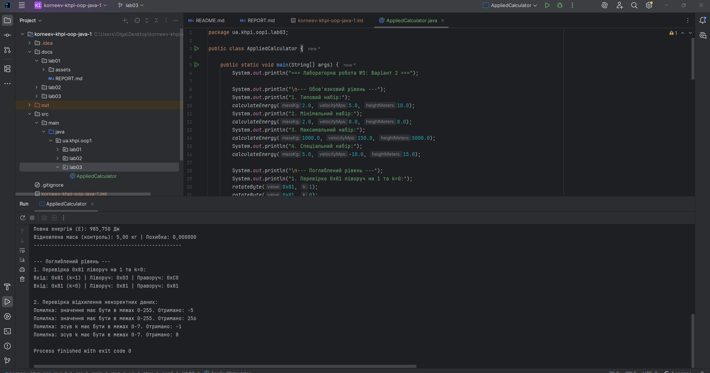

# Звіт з лабораторної роботи № 3

**Тема:** Прикладні обчислення, вирази й оператори
- **Виконав:** Корнєєв Кирил, КН-1025
- **Варіант:** 2

**Репозиторій:** https://github.com/KirillKorneevKH-1025/korneev-khpi-oop-java-1
**Гілка:** `lab03`
**Pull Request:** https://github.com/KirillKorneevKH-1025/korneev-khpi-oop-java-1/pull/4

## Мета
Точний переклад прикладної формули у вирази Java з обґрунтованими типами проміжних результатів, явним порядком операцій, розмірнісною перевіркою та відтворюваним набором тестових даних.

## Обов'язковий рівень варіант 2
**Завдання:** Обчислити дві енергії (кінетичну та потенціальну) та їх суму з контролем одиниць.

## Поглиблений рівень - B
**Завдання:** Циклічне обертання беззнакового байта. Реалізувати циклічне обертання восьми бітів ліворуч і праворуч.

## Аналіз задачі

### Формули, одиниці та умови
Вхідні дані: маса $m$ (кг), швидкість $v$ (м/с), висота $h$ (м).
Формули: $E_k = \frac{1}{2} m v^2$ (Дж); $E_p = m g h$ (Дж); $E = E_k + E_p$ (Дж). Прискорення $g = 9.81$ м/с².
Обмеження (Поглиблений рівень): значення від 0 до 255, зсув $k$ від 0 до 7.

### Дерево основного виразу
Дерево для кінетичної енергії `0.5 * massKg * Math.pow(velocityMps, 2)`:
- Множення `*` (рівень пріоритету 2) асоціативне зліва направо.
- Спочатку обчислюється `0.5 * massKg`, потім результат множиться на значення, яке повертає метод `Math.pow()`.

### Таблиця проміжних значень
| Крок | Підвираз | Тип | Значення (Типовий набір) | Одиниця |
|---|---|---|---|---|
| 1 | `velocitySquared = Math.pow(v, 2)` | `double` | $25.0$ | м²/с² |
| 2 | `kineticEnergyJoules = 0.5 * m * velocitySquared` | `double` | $25.0$ | Дж |
| 3 | `potentialEnergyJoules = m * GRAVITY * h` | `double` | $196.2$ | Дж |
| 4 | `totalEnergyJoules = E_k + E_p` | `double` | $221.2$ | Дж |

### Блок-схема
1. Задати вхідні дані ($m, v, h$) та нормалізувати їх.
2. Обчислити іменовані підформули ($E_k$ та $E_p$).
3. Обчислити повну енергію ($E$).
4. Перевірити контрольну властивість (зворотний розрахунок маси).
5. Вивести результати з одиницями вимірювання.

## Структура класів
Клас `AppliedCalculator` містить три статичні методи:
- `main` — точка входу, що виконує виклик тестових наборів.
- `calculateEnergy` — реалізація логіки обов'язкового рівня.
- `rotateByte` — реалізація логіки поглибленого рівня (бітові зсуви).

## Алгоритми та опис програми

### Пріоритет, типи та порядок обчислення
Для розрахунку енергії використовується тип `double`. Для зсуву байтів використовується `int` з маскуванням `& 0xFF`, щоб відкинути знакові біти після зсуву. Зсув має вищий пріоритет за побітове АБО (`|`), тому в коді зсуви додатково згруповані дужками.

### Компіляція і запуск
```bash
# Компіляція програми:
javac -encoding UTF-8 -d out src/main/java/ua/khpi/oop1/lab03/AppliedCalculator.java

# Запуск програми:
java -cp out ua.khpi.oop1.lab03.AppliedCalculator
```

## Тестування і визначення набору даних

| № | Вхідні дані | Очікуваний результат | Фактичний результат | Статус |
|---|---|---|---|---|
| 1 | Типовий: m=2, v=5, h=10 | $E_k=25.0, E_p=196.2, E=221.2$ | Збігається | ✅ |
| 2 | Мінімальний: m=2, v=0, h=0 | $E_k=0.0, E_p=0.0, E=0.0$ | Збігається | ✅ |
| 3 | Максимальний: m=1000, v=150, h=5000 | $E_k=11250000, E_p=49050000$ | Збігається | ✅ |
| 4 | Спеціальний: m=5, v=-10, h=15 | $E_k=250.0, E_p=735.75, E=985.75$ | Збігається | ✅ |

### Ручний розрахунок
Для $m=2, v=5, h=10$:
$E_k = 0.5 \cdot 2 \cdot 5^2 = 25$ Дж.
$E_p = 2 \cdot 9.81 \cdot 10 = 196.2$ Дж.
$E = 25 + 196.2 = 221.2$ Дж.

### Властивість для незалежної перевірки
Зворотний розрахунок маси: $m = \frac{E_p}{g \cdot h} = \frac{196.2}{9.81 \cdot 10} = 2.0$ кг. Значення збігається з вхідним.

### Ручне тестування операторів
Обертання `0x81` (10000001 в двійковій системі) ліворуч на 1 біт:
Очікується: `0x03` (00000011). Фактичний результат у консолі: `0x03`.

### Налагодження



## Висновки
У ході лабораторної роботи реалізовано прикладну модель розрахунку кінетичної та потенціальної енергії з контролем одиниць вимірювання та незалежною перевіркою результату. Використано типи дійсних чисел та арифметичні оператори з правильним урахуванням пріоритетів. Також успішно виконано поглиблений рівень: реалізовано циклічне обертання байта з використанням бітових операторів зсуву (`<<`, `>>>`) та маскування (`& 0xFF`). Роботу виконано в повному обсязі згідно з методичними вказівками.