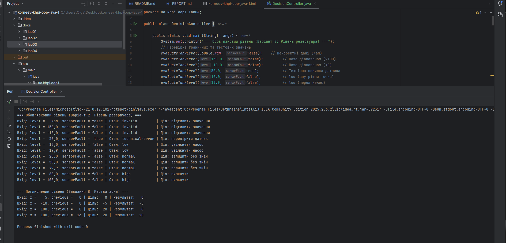

# Звіт з лабораторної роботи № 4

**Тема:** Розгалужені алгоритми
**Виконав:** Korneev Kirill, KN-1025
**Варіант:** 2
**Репозиторій:** https://github.com/KirillKorneevKH-1025/korneev-khpi-oop-java-1
**Гілка:** `lab04`
**Pull Request:** [посилання буде додано після створення PR]

## Мета
Проєктування та реалізація розгалуженого алгоритму Java за формальною специфікацією, використання ланцюжків умов, перевірка граничних значень.

## Обов'язковий рівень (Варіант 2: Рівень резервуара)

### Вхідні дані, пороги та категорії
- `level` (double): скінченне число від 0 до 100%.
- `sensorFault` (boolean): ознака несправності датчика.
- Некоректні дані: `NaN`, нескінченність або значення поза діапазоном `[0, 100]`.
- Межі: 20 (low/normal), 80 (normal/high).

### Таблиця рішень

| Умова або дія | R1 | R2 | R3 | R4 | R5 |
|---|---|---|---|---|---|
| Дані чисельно коректні | ні | так | так | так | так |
| `sensorFault` == true | - | так | ні | ні | ні |
| `level` < 20 | - | - | так | ні | ні |
| `level` < 80 | - | - | - | так | ні |
| **Категорія** | invalid | technical-error | low | normal | high |
| **Дія** | відхилити | перевірити датчик | увімкнути насос | залишити без змін | вимкнути |

### Протокол тестування (Обов'язковий рівень)

| № | Вхідні дані | Очікувана гілка | Фактичний результат | Статус |
|---|---|---|---|---|
| 1 | NaN, false | invalid | invalid | ✅ |
| 2 | -10.0, false | invalid | invalid | ✅ |
| 3 | 50.0, true | technical-error | technical-error | ✅ |
| 4 | 10.0, false | low | low | ✅ |
| 5 | 19.9, false | low (перед межею) | low | ✅ |
| 6 | 20.0, false | normal (межа) | normal | ✅ |
| 7 | 79.9, false | normal (перед межею) | normal | ✅ |
| 8 | 80.0, false | high (межа) | high | ✅ |
| 9 | 100.0, false | high (максимум) | high | ✅ |

---

## Поглиблений рівень
**Завдання В:** Мертва зона й обмеження керувального значення.

### Аналіз задачі
Алгоритм виконує два етапи:
1. Обчислення цільового значення (віднімання/додавання 5) із мертвою зоною `[-5, 5]` та насиченням `[-20, 20]`.
2. Обмеження зміни швидкості: результат не може відрізнятися від `previous` більше ніж на 8.

### Протокол тестування (Поглиблений рівень)

| Вхід: `x`, `previous` | Очікувана ціль | Очікуваний результат | Фактичний результат | Статус |
|---|---|---|---|---|
| 5, 0 | 0 | 0 | 0 | ✅ |
| -10, 0 | -5 | -5 | -5 | ✅ |
| 100, 0 | 20 | 8 | 8 | ✅ |
| 100, 16 | 20 | 20 | 20 | ✅ |

## Тестування і визначення набору даних

## Висновки
Під час виконання роботи було успішно спроєктовано розгалужений алгоритм класифікації рівня рідини в резервуарі (з урахуванням пріоритету апаратних помилок). Правильний порядок перевірок (спочатку валідація, потім статус помилки, потім вужчі діапазони) гарантує відсутність недосяжних гілок і взаємовиключність результатів. На поглибленому рівні реалізовано алгоритм математичного насичення та обмеження кроку зміни керувального сигналу.