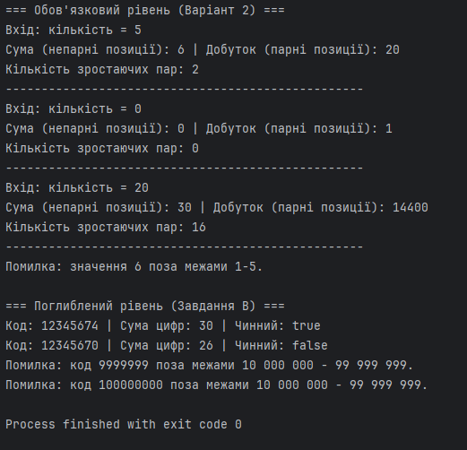

# Звіт з лабораторної роботи № 5

**Тема:** Циклічна обробка послідовностей
- **Виконав:** Корнєєв Кирил, КН-1025
- **Варіант:** 2

**Репозиторій:** https://github.com/KirillKorneevKH-1025/korneev-khpi-oop-java-1
**Гілка:** `lab05`
**Pull Request:** https://github.com/KirillKorneevKH-1025/korneev-khpi-oop-java-1/pull/6

## Мета
Дослідити циклічну обробку послідовностей: спроєктувати стан циклу, визначити його кроки й умову завершення, простежити зміну змінних і перевірити результат на звичайних та граничних даних.

## Обов'язковий рівень (Варіант 2)
**Завдання:** Кількість елементів від 0 до 20, значення від 1 до 5. Для позицій з непарними номерами знайти суму, з парними — добуток. Якщо група порожня, вивести 0 для суми або 1 для добутку. Порахувати сусідні pairs, де друге значення більше за перше.

### Аналіз задачі та опис алгоритму
Для обов'язкового рівня обрано цикл `for` з лічильником `i`, оскільки загальна кількість ітерацій (довжина масиву `n`) відома заздалегідь. Усередині циклу поточна позиція обчислюється як `i + 1`. Стан циклу зберігається в акумуляторах `sum` (початкове 0) та `product` (початкове 1). Для перевірки пар зберігається змінна `previousValue`.

### Трасування циклу (набір {2, 4, 1, 5})
| i | value | позиція | sum | product | pairCount | previousValue |
|---|---|---|---|---|---|---|
| 0 | 2 | 1 (непарна) | 2 | 1 | 0 | 2 |
| 1 | 4 | 2 (парна) | 2 | 4 | 1 (4 > 2) | 4 |
| 2 | 1 | 3 (непарна) | 3 | 4 | 1 | 1 |
| 3 | 5 | 4 (парна) | 3 | 20 | 2 (5 > 1) | 5 |

### Тестування обов'язкового рівня
| № | Вхід | Очікувано | Фактично | Статус |
|---|---|---|---|---|
| 1 | `2, 4, 1, 5, 3` | sum=6, prod=20, pairs=2 | sum=6, prod=20, pairs=2 | ✅ |
| 2 | Мінімальний `[]` | sum=0, prod=1, pairs=0 | sum=0, prod=1, pairs=0 | ✅ |
| 3 | Граничний (20 ел-тів) | sum=30, prod=345600 | sum=30, prod=345600 | ✅ |
| 4 | Помилка `2, 6, 1` | Відхилення (6 > 5) | Помилка: 6 поза межами | ✅ |

---

## Поглиблений рівень (Завдання B)
**Завдання:** Перевірка восьмизначного коду (10 000 000 – 99 999 999) за алгоритмом Луна. Подвоювати кожну другу цифру справа наліво.

### Аналіз задачі та опис алгоритму
Використано цикл `while (temp > 0)`, оскільки кількість цифр зменшується шляхом цілочисельного ділення `/ 10` до повного обнулення змінної. Прапорець `isSecond` перемикається на кожній ітерації `!isSecond`, визначаючи, чи потрібно подвоювати поточну цифру (остання цифра не подвоюється).

### Тестування поглибленого рівня
| № | Вхід | Очікувано | Фактично | Статус |
|---|---|---|---|---|
| 1 | `12345674` | Сума: 30, Чинний: true | Сума: 30, Чинний: true | ✅ |
| 2 | `12345670` | Сума: 26, Чинний: false | Сума: 26, Чинний: false | ✅ |
| 3 | `9999999` | Помилка діапазону | Помилка діапазону | ✅ |

## Результати тестування

## Висновки
У ході лабораторної роботи успішно реалізовано алгоритми циклічної обробки послідовностей. Для обов'язкового рівня застосовано цикл `for` з індексами для обробки парних і непарних позицій та агрегування сум і добутків. Для поглибленого рівня реалізовано алгоритм Луна з використанням циклу `while`, що виконує виділення десяткових цифр за допомогою операторів `% 10` та `/ 10`. Продемонстровано розуміння зміни стану ітеративних алгоритмів та коректну обробку граничних і помилкових значень.