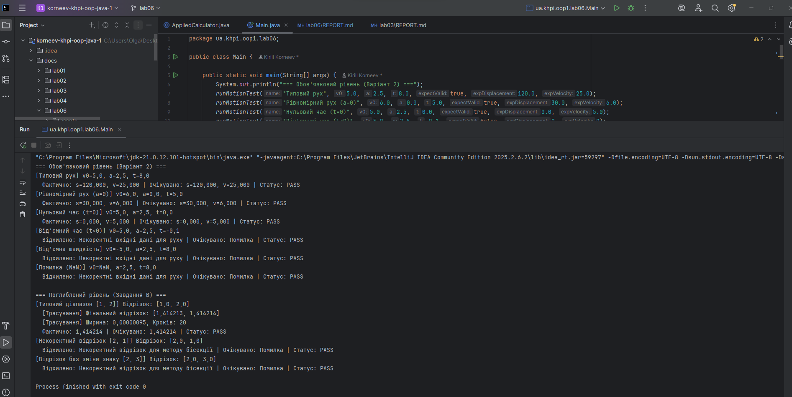

# Звіт з лабораторної роботи № 6

**Тема:** Декомпозиція консольної програми на методи
- **Виконав:** Корнєєв Кирил, КН-1025
- **Варіант:** 2

**Репозиторій:** https://github.com/KirillKorneevKH-1025/korneev-khpi-oop-java-1
**Гілка:** `lab06`
**Pull Request:** https://github.com/KirillKorneevKH-1025/korneev-khpi-oop-java-1/pull/7

## Мета
Навчитися ділити консольну програму на методи з чіткими параметрами, результатами й відповідальністю та перевіряти обчислювальні методи окремо від введення і виведення.

## Обов'язковий рівень (Варіант 2)
**Завдання:** Обчислити переміщення й кінцеву швидкість для рівноприскореного руху з перевіркою часу.

### Аналіз задачі та опис алгоритму
Логіку розбито на три методи:
1. `isValidMotionInput` (повертає `boolean`) — перевіряє скінченність даних та те, що час і початкова швидкість є невід'ємними числами.
2. `calculateDisplacement` (повертає `double`) — обчислює переміщення $s = v_0t + \frac{at^2}{2}$. Викликає перевірку даних і кидає `IllegalArgumentException` або `ArithmeticException` у разі помилки.
3. `calculateFinalVelocity` (повертає `double`) — обчислює кінцеву швидкість $v = v_0 + at$ з аналогічним захистом.

Обчислення повністю відокремлені від консольного виведення, що виконується у допоміжному методі `runMotionTest`.

### Тестування обов'язкового рівня
| № | Вхідні дані ($v_0, a, t$) | Очікувано | Фактично | Статус |
|---|---|---|---|---|
| 1 | Типовий рух (5.0, 2.5, 8.0) | s=120.0, v=25.0 | s=120.0, v=25.0 | PASS |
| 2 | Рівномірний рух (6.0, 0.0, 5.0) | s=30.0, v=6.0 | s=30.0, v=6.0 | PASS |
| 3 | Нульовий час (5.0, 2.5, 0.0) | s=0.0, v=5.0 | s=0.0, v=5.0 | PASS |
| 4 | Від'ємний час (5.0, 2.5, -0.1) | Помилка `IllegalArgumentException` | Відхилено | PASS |
| 5 | Помилка NaN (`NaN`, 2.5, 8.0) | Помилка `IllegalArgumentException` | Відхилено | PASS |

---

## Поглиблений рівень (Завдання B)
**Завдання:** Для функції $f(x)=x^2-2$ знайти корінь методом бісекції на відрізку [1, 2] з точністю $10^{-6}$ або не більше 40 кроків. Метод має повертати лише наближення, а фінальну ширину і кроки виводити у трасуванні.

### Аналіз задачі та опис алгоритму
Реалізовано три методи:
1. `f` — цільова функція $f(x)=x^2-2$.
2. `isValidBisectionInterval` — перевіряє скінченність, строгу нерівність $left < right$ та те, що знаки функції на кінцях відрізка відрізняються ($f(left) \cdot f(right) \le 0$).
3. `findRootBisection` — виконує ітеративний пошук. Якщо новий відрізок задовольняє умову, межі зсуваються до `mid`. Умова виходу: ширина відрізка $\le 10^{-6}$ або `step == 40`.

### Трасування (для відрізка [1, 2])
- Початково $f(1)=-1, f(2)=2$.
- Фінальний відрізок: `[1.414213, 1.414214]`
- Фінальна ширина: `0.00000095`
- Кількість кроків: `20`

### Тестування поглибленого рівня
| № | Вхід (відрізок) | Очікувано | Фактично | Статус |
|---|---|---|---|---|
| 1 | `[1, 2]` | 1.414214 | 1.414214 | PASS |
| 2 | `[2, 1]` | Помилка (left > right) | Відхилено | PASS |
| 3 | `[2, 3]` | Помилка (немає зміни знаку) | Відхилено | PASS |

## Результати тестування

## Висновки
У ході виконання лабораторної роботи консольну програму було успішно декомпозовано на окремі методи. Для обов'язкового рівня створено окремі методи перевірки коректності даних, обчислення переміщення та швидкості, які генерують винятки при некоректних даних. Для поглибленого рівня реалізовано метод бісекції із суворим дотриманням контракту (повернення скалярного значення). Усі обчислення повністю відокремлено від операцій виведення, а тести оформлено у вигляді незалежних автоматичних перевірок, що успішно покривають типові, граничні та хибні набори даних.